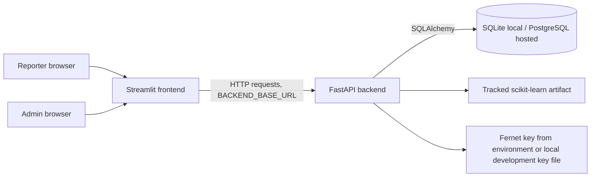
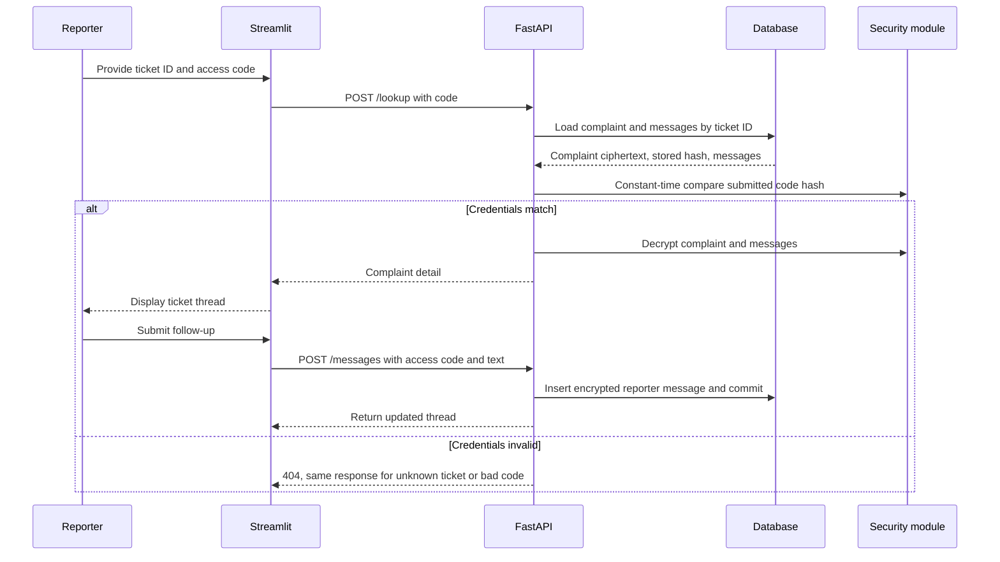
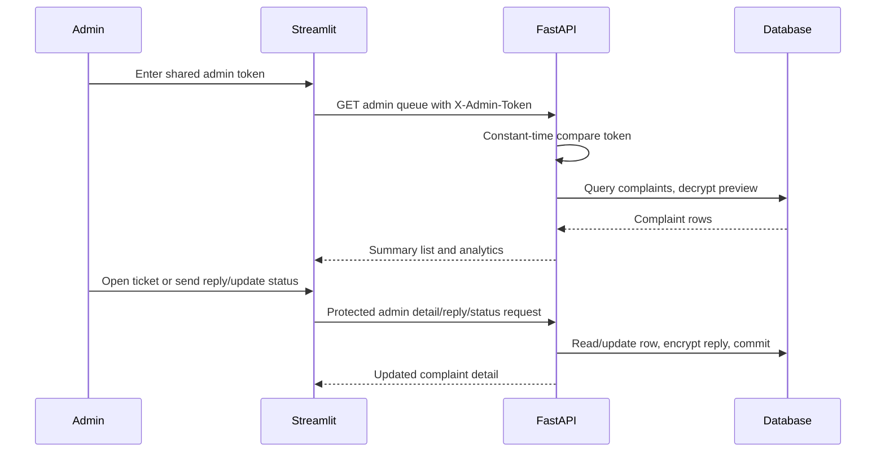
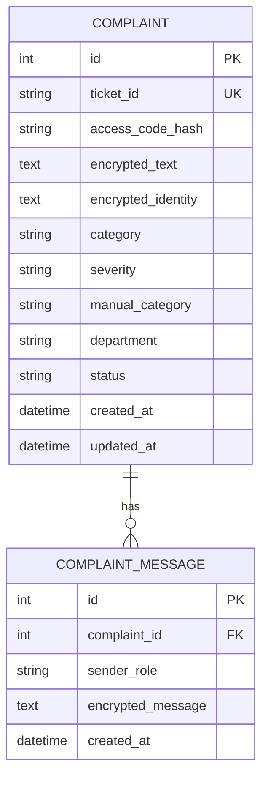

# SafeSpace Pro architecture

This document describes the code in the repository, not a target architecture. Gaps are labeled as gaps rather than represented as implemented controls.

## 1. System overview

The application is a Python monorepo with two runtime processes:

- **Streamlit frontend** (`frontend/app.py`) renders report submission, ticket lookup/follow-up, and the administrator dashboard. It calls the API through `frontend/client.py` using the `requests` library.
- **FastAPI backend** (`backend/main.py`) validates requests, loads the classifier, initializes SQLAlchemy tables, encrypts data, and exposes reporter/admin routes.
- **Database** stores complaint and message rows. SQLite is used for local development; Render's Blueprint connects the API to PostgreSQL.
- **Classifier artifact** (`backend/model_artifacts/harassment_classifier.joblib`) is loaded lazily by the service function and eagerly at application startup so a missing/corrupt artifact prevents startup.



Hosted topology is two Render Python web services plus Render PostgreSQL. The frontend service receives the backend host from the Blueprint `fromService` reference and normalizes a host-only value to HTTPS. The frontend makes server-to-server calls; no browser-to-API CORS permission is required for this UI.

## 2. Repository and module responsibilities

| Module/path | Responsibility |
| --- | --- |
| `backend/main.py` | FastAPI app, startup model load, `create_all()`, CORS middleware, root response |
| `backend/api/routes.py` | API routes and admin-token dependency |
| `backend/core/config.py` | Pydantic environment settings, URL normalization, production configuration validation |
| `backend/core/security.py` | Fernet cipher, encryption/decryption, access-code hash/verification, ticket/access-code generation |
| `backend/db/base.py` | SQLAlchemy declarative base |
| `backend/db/models.py` | `Complaint`, `ComplaintMessage` ORM entities |
| `backend/db/session.py` | Engine, session factory, request-scoped session dependency |
| `backend/schemas.py` | Pydantic request and response contracts and allowed category/status values |
| `backend/repositories.py` | Business operations, DB queries and commits, response serialization, analytics |
| `backend/services/classifier.py` | Model loading/category inference and severity rules |
| `frontend/app.py` | Streamlit pages and interactive flows |
| `frontend/client.py` | HTTP requests, backend error translation, admin header |
| `scripts/train_model.py` | Trains the small demonstration model and overwrites the checked-in artifact |
| `tests/test_api.py` | API flows and cryptographic checks against an isolated temporary SQLite DB |
| `api/index.py`, `vercel.json` | Legacy Vercel API entry/routing configuration; not used by the Render design and not verified for current Vercel behavior |

## 3. Routes and request flows

Routes are mounted under `/api/v1`.

| Method | Route | Access | Behavior |
| --- | --- | --- | --- |
| `GET` | `/health` | Public | Executes `SELECT 1` against the configured DB, then returns app/status |
| `POST` | `/complaints` | Public | Validates submission, classifies, encrypts, persists complaint and initial reporter message, returns ticket and access code |
| `POST` | `/complaints/{ticket_id}/lookup` | Ticket ID + access code | Returns complaint content and messages when the access code hash matches |
| `POST` | `/complaints/{ticket_id}/messages` | Ticket ID + access code | Persists encrypted reporter follow-up and returns the updated detail |
| `GET` | `/admin/complaints` | `X-Admin-Token` | Returns summary records and decrypted complaint previews with optional exact filters |
| `GET` | `/admin/complaints/{ticket_id}` | `X-Admin-Token` | Returns complaint and thread |
| `POST` | `/admin/complaints/{ticket_id}/messages` | `X-Admin-Token` | Stores encrypted admin reply; changes `OPEN` to `UNDER_REVIEW` |
| `PATCH` | `/admin/complaints/{ticket_id}/status` | `X-Admin-Token` | Sets one of the four allowed statuses |
| `GET` | `/admin/analytics` | `X-Admin-Token` | Aggregates all complaints in application memory |

`ComplaintCreate.text` allows 10–5000 characters, optional identity up to 120 characters, department up to 80, and manual category up to 50. Messages allow 1–2000 characters. Validation errors are Pydantic/FastAPI 422 responses. Invalid ticket/access-code combinations return 404 to avoid distinguishing absent tickets from incorrect access codes. Admin token failures return 401.

### Complaint submission

```mermaid
sequenceDiagram
    participant R as Reporter
    participant UI as Streamlit
    participant API as FastAPI
    participant C as Classifier
    participant S as Security module
    participant DB as SQLAlchemy database
    R->>UI: Submit report and optional identity
    UI->>API: POST /api/v1/complaints
    API->>API: Validate Pydantic request
    API->>C: Predict category and confidence
    C-->>API: Category and confidence
    API->>API: Infer severity from terms/confidence
    API->>S: Generate ticket/access code; encrypt fields; hash code
    S-->>API: Ticket, plaintext one-time code, ciphertext, SHA-256 hash
    API->>DB: Insert Complaint and encrypted initial message; commit
    DB-->>API: Persisted complaint
    API-->>UI: Return ticket and plaintext access code once
    UI-->>R: Display credentials for saving
```

The reporter code is now generated with `secrets.token_hex(16)` (32 uppercase hexadecimal characters, 128 bits). Only a SHA-256 digest is stored; comparison uses `hmac.compare_digest`. The plaintext value is returned from submission and is not stored. A hash is not a recovery mechanism: the reporter must retain the code. Previously issued 8-character access codes remain accepted for compatibility if an older database is migrated; those legacy credentials have less entropy and should be treated as a separate migration risk.

### Reporter ticket lookup and follow-up



The ticket ID is included in path URLs; it is an identifier, not a password. Platform access logs may retain request paths. The code has no rate limiter for lookup attempts (the generated code has high entropy, but abuse controls remain a production gap).

### Admin review



Administration is based on one shared environment token and has no individual accounts, role separation, login session, MFA, token expiry, or audit history.

## 4. Data model and lifecycle

`Complaint` has a one-to-many relationship to `ComplaintMessage`:



The ORM enforces unique `ticket_id`; `ComplaintMessage.complaint_id` references `complaints.id` with cascade deletion. Indexes exist on complaint ID, ticket ID, category, severity, status, and message foreign key. There is no database-level check constraint for category/status/sender role; Pydantic constrains manual category, status updates, and output sender roles.

Statuses accepted by the API are `OPEN`, `UNDER_REVIEW`, `RESOLVED`, and `CLOSED`. A new complaint is `OPEN`; the first admin reply changes it to `UNDER_REVIEW` only if currently `OPEN`. Admin status updates can set any allowed value from any current state; there is no formal transition graph. Reporter messages do not change status.

### Database/session and transaction lifecycle

`backend/db/session.py` creates one global SQLAlchemy engine with `pool_pre_ping=True` and a `SessionLocal` factory. SQLite connections use `check_same_thread=False`. `get_db()` yields one session per route and closes it in `finally`. Repository writes call `commit()`; SQLAlchemy errors are not converted by a custom exception handler. Closing a session rolls back any uncommitted transaction. The app lifespan disposes the engine on shutdown (including startup failures).

At startup, the FastAPI lifespan loads the classifier and calls `Base.metadata.create_all()`. This initializes a new schema but is not a migration mechanism: it does not add/alter columns in existing tables or manage versioned upgrades. There is no Alembic configuration or migration history. This is a material production blocker.

## 5. Encryption, authentication, and sensitive data

### Encryption boundaries

Fernet encryption is applied before persistence to complaint text, optional identity, and each conversation message. The key is supplied by `FERNET_KEY`; local development can create/read `data/fernet.key` if the environment key is absent. Production configuration rejects a missing/invalid key and refuses to rely on a generated local file. Decryption errors now fail instead of returning placeholder text.

These values are **not encrypted by application code**: ticket ID, access-code digest, category, severity, manual category, department, status, sender role, and timestamps. A database or backup operator can still observe these metadata. Encryption does not hide data from the running API/admin UI or protect against compromise of the key and process.

No key identifier, key ring, rotation helper, or recovery mechanism exists. Changing the Fernet key makes existing ciphertext unreadable. Back up the key separately from database backups and test recovery procedures.

### Access control

- Reporter ticket access requires the generated ticket ID and the high-entropy access code; only the digest is persisted. Missing/invalid credentials produce the same 404.
- Admin routes use the `X-Admin-Token` header. Comparison is constant-time. `APP_ENV=production` requires an explicit token at least 32 characters long.
- The Streamlit admin page asks for the same shared token and sends it with requests. This is not user-specific authorization.
- Public complaint submission is intentionally unauthenticated, but no rate limiting, abuse detection, captcha, idempotency key, or spam controls exist.
- CORS only permits the configured exact origins, with no credentials and limited methods/headers. The Render Blueprint leaves origins empty because its Streamlit-to-API calls occur server-side. Streamlit XSRF and CORS protections are enabled in `.streamlit/config.toml`.

### Anonymity, logging, and privacy

The UI makes identity optional, but the application cannot promise full anonymity. The host, database provider, network infrastructure, and operational access logs may expose IP/request metadata; ticket IDs occur in URL paths. Identity and complaint content are returned to authorized callers after decryption. There is no retention/deletion feature, privacy notice, audit trail, or support process. Do not collect real reports until these requirements have an explicit owner and implementation.

FastAPI/Starlette supplies generic error handling; there is no application logging framework or sensitive-payload logging code. Uvicorn and the hosting platform may log request paths and service events. Avoid enabling debug mode or adding payload/token logging.

## 6. Classifier behavior

The checked-in `Pipeline` is a TF-IDF vectorizer and logistic-regression classifier trained by `scripts/train_model.py` on 22 hard-coded illustrative sentences. It predicts the categories `verbal harassment`, `physical harassment`, `digital harassment`, or `other` with a confidence score. The app pins scikit-learn to the artifact's 1.8.0 serialization version, loads the artifact at startup, then caches it. Joblib uses Python object serialization; only load a reviewed, trusted artifact from this repository/build process.

Severity is not an ML classifier: `infer_severity` checks a fixed set of substrings in the original text and assigns `HIGH`, `MEDIUM`, or `LOW`, with a confidence fallback. These outputs are demonstrative, have no documented evaluation or calibration, and must not drive real risk/disciplinary decisions. Missing model artifact is a startup error; there is no hidden heuristic fallback.

## 7. Environment and deployment

`backend/core/config.py` uses Pydantic Settings with project-root `.env`, case-insensitive environment keys, and unknown-variable ignore. The Streamlit client reads only `BACKEND_BASE_URL` from that file for local runs; it does not export the backend's other secrets into its process environment. Key values:

- `APP_ENV`: development unless explicitly production.
- `DATABASE_URL`: local SQLite by default; common `postgres://`/`postgresql://` schemes are translated for `psycopg`.
- `ADMIN_TOKEN`, `FERNET_KEY`: local defaults/fallbacks differ from production requirements.
- `FERNET_KEY_FILE`: local-only file fallback.
- `MODEL_PATH`: relative path to tracked model.
- `TICKET_PREFIX`: `SAFE`.
- `CORS_ORIGINS`: comma-separated origins, local Streamlit origins by default.
- `BACKEND_BASE_URL`: consumed by the Streamlit client, not backend service configuration.

The Render Blueprint's API and UI use the repo root, Python runtime, `$PORT`, and the same Oregon region as PostgreSQL. API `DATABASE_URL` is a Render database reference; UI `BACKEND_BASE_URL` is a service-host reference. The API health probe checks the DB. Free web services have ephemeral filesystems and idle spin-down; free Postgres has a 30-day expiry and no backup capability per Render's current [free plan docs](https://render.com/docs/free). These are demo-only deployment settings.

Docker Compose runs the same two processes locally. The backend is mounted to local `./data`; this is not a cloud persistence guarantee. `api/index.py` and `vercel.json` are retained legacy files and are not part of the target Render architecture.

## 8. Failures and recovery

| Failure | Current behavior |
| --- | --- |
| Missing model | Startup raises `FileNotFoundError`; service should not become healthy. |
| Invalid/missing production secrets or SQLite URL | Settings validation stops process startup with a non-secret error message. |
| Database unavailable | `create_all()` or health probe fails; Render health check should fail. |
| Fernet key changed | Decryption raises a generic runtime error; affected request fails instead of presenting false plaintext/placeholder output. |
| Database restore without Fernet key | Ciphertext is not usable; restore both database and matching key from protected backups. |
| Schema change without migration | `create_all()` will not upgrade existing columns; deployment may fail at query time. |
| Free service sleeps | First request may wait for spin-up; local filesystem state is not durable. |
| Free database expires | Database becomes unavailable after its documented expiration; no free-plan backup recovery is available. |

The app has no backup/restore automation, migration mechanism, key rotation workflow, or alerting. A code rollback does not undo database mutations.

## 9. Technical debt and roadmap

Before accepting real reports, prioritize:

1. Add managed individual admin identities, MFA, role-scoped access, short-lived sessions, and audited administrative actions.
2. Add edge/API rate limits, abuse controls, request size/timeout controls, and suitable monitoring without logging sensitive payloads.
3. Add Alembic migrations and controlled deployment ordering; test fresh install, upgrade, and rollback on disposable PostgreSQL.
4. Define encryption-key versioning and tested offline re-encryption/rotation plus recovery procedure.
5. Define retention, deletion, legal/privacy notice, incident response, access logging, and backup/restore objectives.
6. Evaluate classifier data quality and severity behavior with domain experts; do not present unvalidated output as an authoritative risk score.
7. Add pagination and database-side aggregation for unbounded admin list/analytics queries; add idempotency and spam protection as product requirements demand.
8. Validate deployment resource sizing, dependency vulnerabilities, TLS/network policy, and Render plan/backup details on the actual account.

For operational steps, see [SETUP.md](SETUP.md). For the quick overview, see [README.md](README.md).
